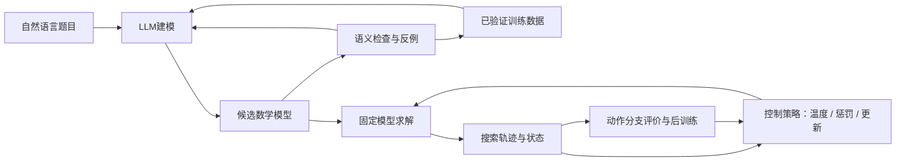

# p-bit × 大模型 × 组合优化：前沿、重合度与QIHC定位

调研截止：2026-11-12，Asia/Shanghai。范围：25项核心文献，覆盖2017—2026年；区分正式发表、作者标注录用及预印本。本文是研究定位调研，不是新实验结果，不启动服务器训练。

配套：[25篇文献库与PDF清单](PBIT_LLM_SOLVER_LIBRARY_20261112.md) · [检索和下载清单](PBIT_LLM_SOLVER_SOURCES_20261112.json) · [项目反馈/后训练指标](../experiments/FEEDBACK_POSTTRAINING_COMPARISON_20261112.md)。

## 1. 先回答：是否有高度重合的工作

**有，且分别覆盖了你的建模反馈、反馈后训练和搜索过程控制。** 本轮未核实到一篇同时完整包含“p-bit主动条件反例、独立语义验证、验证修复蒸馏、分段搜索控制后训练”的论文；这只说明本轮检索尚未找到完整同构方案，不能据此宣称首创。

目前最需要正面对照的不是名字中有没有p-bit，而是：

- **COVER、ORSMT**：求解器找语义反例、定位、修复、重新验证，与P-VCD前半段接近。
- **SIRL、OMSO、PEARL、OptiMind、SAGE**：求解反馈参与建模后训练；“LLM加求解器再强化学习”已经是成熟研究路线。
- **SDPO**：将富反馈转为自蒸馏信号，与P-VCD的学习机制直接相邻。
- **LLM-ALNS、COOL**：前者让LLM根据搜索遥测在线调参，后者用RL学习退火调度；分别贴近E005-1.11的接口和控制目标。
- **CALM**：搜索评价反过来训练LLM生成算法，说明“把求解经验用于后训练”本身也不是空白。

这组结论是本文对下列原论文和项目记录的综合判断，**不是任何论文作者对QIHC的评价**。方法重合不等于完全重复，但会改变需要证明的贡献。

## 2. 你的项目实际上包含两个不同学习问题

| 维度 | P-VCD建模线 | E005-1.11控制线 |
|---|---|---|
| 要学什么 | 把题目建成正确的变量、目标和约束 | 在固定正确模型上更有效地搜索 |
| 主要观测 | 题面、候选IR、语义反例/诊断 | 可行率、违约、群体多样性、停滞与历史进展 |
| 动作 | 改数学模型或代码 | 保持、降温、升温、加强惩罚、平衡惩罚 |
| 正确信号来源 | 训练划分的参考语义及独立验证 | 原始固定模型的可行性与目标质量 |
| 当前训练形式 | 奖励训练及已验证修复蒸馏 | 离线分支偏好、动作SFT/DPO |
| 最近邻 | COVER、ORSMT、SDPO、PEARL | LLM-ALNS、COOL、2D-PT |
| 最重要风险 | 验证目标与真实题意不一致；修复正样本稀疏 | 学成固定降温；短视标签；推理成本超过搜索收益 |

项目依据：[E005-1.8执行记录](../experiments/E005_posttraining/E005-1.8_execution.md)、[E005-1.9诊断](../experiments/E005_posttraining/E005-1.9_analysis_20261112_pilot_001.md)、[E005-1.11记录](../experiments/E005_posttraining/E005-1.11_record.md)。

左侧“模型是否对”与右侧“搜索是否好”必须分开评价。错误模型的低能量解，不是原题的正确解；正确模型的一次较差搜索，也不是建模失败。

## 3. 目前前沿如何分布

| 路线 | 前沿重点 | 代表证据 | 对你的含义 |
|---|---|---|---|
| 自动建模 | 多轮执行修复、策略选择、跨solver迁移 | [PEARL](https://arxiv.org/abs/2607.18256v2)、[OMSO](https://arxiv.org/abs/2604.00442v2)、[SAGE](https://proceedings.mlr.press/v306/zhao26z.html) | 单轮NL→IR已经不足以构成主要新意 |
| 语义可靠性 | 检查“能运行但建错了”，建立证据和拒绝机制 | [COVER](https://journals.sagepub.com/doi/10.3233/FAIA260737)、[ORSMT](https://arxiv.org/abs/2610.29145v1)、[Falsification](https://arxiv.org/abs/2607.16646v1) | 与你的反例方向最接近，也最需要直接比较 |
| 后训练 | 用结果、富反馈或完整交互轨迹训练模型 | [SIRL](https://arxiv.org/abs/2505.11792v3)、[SDPO](https://arxiv.org/abs/2601.20802v2)、[OptiMind](https://www.microsoft.com/en-us/research/publication/multi-turn-rl-makes-small-language-model-competitive-for-optimization-modeling/) | 需要证明反馈内容和数据选择的额外价值 |
| 算法生成与控制 | 离线发现启发式、在线状态控制、搜索与生成器共同学习 | [ReEvo](https://arxiv.org/abs/2402.01145)、[CALM](https://proceedings.iclr.cc/paper_files/paper/2026/hash/75ed738c083f8941cfc990245e4f6265-Abstract-Conference.html)、[LLM-ALNS](https://www.mdpi.com/2079-8954/14/10/1200) | 离线写算法与在线选动作应分开定位 |
| p-bit求解 | 并行更新、连接代价、温度/惩罚联合探索、非二值表示 | [pc-COP](https://arxiv.org/abs/2504.04543)、[2D-PT](https://arxiv.org/abs/2601.09037v2)、[p-dits](https://arxiv.org/abs/2506.00269v1) | 仅CPU软件小规模实验暂不能支持硬件加速贡献 |

不能把这些论文在不同数据集上的“准确率”“归一化cut”“目标一致率”拼成排行榜。它们回答的不是同一个任务，输入权限、成本和正确性标准也不同。

## 4. 与你最重合的工作：逐项比较

以下“高/中”是机制层面的定性判断，不是相似度模型分数。

| 工作 | 与P-VCD重合 | 与控制线重合 | 已覆盖的核心 | 仍可研究的差异 |
|---|---|---|---|---|
| COVER，2026 | 高 | 低 | typed IR、反例、局部修复、回归检查 | 主动反例选择、训练时蒸馏、采样效率 |
| ORSMT，2026-10 | 高 | 低 | 精确语义关系、反例定位、修复后验证 | 概率搜索何时更有效、预算与覆盖权衡 |
| SAC-Opt，2026版本 | 中高 | 低 | 源语义对齐、细粒度纠错 | 采样证据相对LLM审阅的独立贡献 |
| PEARL，2026-11 v2 | 高 | 中低 | 多轮求解交互策略后训练 | 你修复数据的严格语义认证；固定模型内部控制 |
| OMSO / SIRL | 高 | 低 | 求解器结果奖励与造数 | 稠密反例是否优于结果标量 |
| SDPO | 高：学习机制 | 低 | 富反馈条件化自教师、蒸馏 | 反例选择与验证门控，而非蒸馏公式本身 |
| LLM-ALNS，2026 | 低 | 高 | 遥测→有界控制动作→继续搜索 | 它免训练；你做轨迹后训练与跨任务泛化 |
| COOL，2020 | 低 | 高 | RL学习升温/降温控制 | 语言/结构语义是否比小网络状态策略有用 |
| CALM，ICLR2026 | 中 | 中 | 搜索评价用于LLM权重更新 | 它生成启发式程序，你逐段选固定动作 |
| 2D-PT，2026 v2 | 低 | 中高：控制变量 | 同时探索温度与惩罚强度 | 学习决策相对副本交换的成本收益 |
| LLM-QUBO，2025 | 中 | 低 | 自然语言到结构模型与QUBO | 主动诊断与后训练，不是仅把NL接到能量求解器 |

### 4.1 COVER：最直接的反例修复近邻

它用typed IR承载模型，求解器寻找候选与参考/测试间的不一致，诊断定位后局部修补。正文的75/101是**oracle设置下的solution-level指标**；不能拿来与我们的780完整语义正确率直接比较。关键差异候选是“你如何选择更有价值的反例并把修复学回模型”，而非“首次用反例修模型”。[原文方法3.3—3.5与实验4](https://journals.sagepub.com/doi/10.3233/FAIA260737)

### 4.2 ORSMT：不能忽略的精确验证对照

该工作区分可行域、目标排序、目标值及源要求，能够投影辅助变量并返回反例。它也明确承认：数学模型与代码一致，仍可能共同漏掉题意。对QIHC而言，“独立验证”不是天然独占的创新；更合理的问题是概率采样能否以更低预算提供互补证据。未形式化的源内容仍有未决项。[原文第3—4节](https://arxiv.org/html/2610.29145v1)

### 4.3 PEARL：已学习“何时调用求解器、修订、停止”

这属于建模工作流的控制，不是固定模型内部的温度调度。v2正文显示：交互中看到执行反馈，训练终端另与参考目标比较，参考比较不回传为工具观测；目标一致也不检查全部题意约束。这使“语义认证的反馈数据”仍是可研究差异，但不能把多轮solver-interactive训练写成新概念。[第3节及附录A.2](https://arxiv.org/html/2607.18256v2)

### 4.4 LLM-ALNS：与新控制接口最像

它把分段搜索状态整理为结构化遥测，让LLM调整算子、破坏程度、温度/冷却及重启；解构造与可行性由确定性程序负责。论文是**免训练监督器**，报告9个实例在同迭代预算下的收益，同时承认更高计算成本。你的后训练与跨问题泛化可形成差异，但“读状态再调参”本身已经被覆盖。[正式论文](https://www.mdpi.com/2079-8954/14/10/1200)

### 4.5 COOL和CALM：两类容易漏掉的近邻

COOL早已把退火调度作为RL控制问题，包含先加热再降温的学习行为，因此小网络RL是必要对照。[COOL](https://arxiv.org/abs/2003.00011v2) CALM则以启发式实际表现对LLM做RL，使搜索与生成器共同演进。它与每段动作决策不同，但覆盖了“搜索反馈训练大模型”这一上层思路。[CALM](https://proceedings.iclr.cc/paper_files/paper/2026/hash/75ed738c083f8941cfc990245e4f6265-Abstract-Conference.html)

### 4.6 无参考验证和经验准入：与你造正反例直接相关

Falsification研究通过参数变换找模型矛盾，但有检测盲区，且实现中的A5依赖探测尺度条件，不宜照搬“零假阳性”的泛化表述。[正文Remark4.5](https://arxiv.org/html/2607.16646v1) AdmitOR用跨模型族与重采样一致性决定经验是否进入库；其摘要明确指出校准集上的错误发现界没有在基准流成立。[v6](https://arxiv.org/abs/2608.15565v6) 两者提示：样本质量、弃权和错误传播应成为造数实验的主指标。

## 5. p-bit本身的前沿在哪里

p-bit是概率单元/实现框架；退火、PT是调度或多副本策略。**p-bit与PT可以组合**，不能只列成互斥的三种求解器。软件heat-bath实现也不能自动继承磁器件/FPGA的能耗优势。

| 文献 | 值得关注的进展 | 对QIHC的直接启发 |
|---|---|---|
| [2017可逆逻辑](https://journals.aps.org/prx/abstract/10.1103/PhysRevX.7.031014) | 钳位部分变量后对其余状态条件采样 | 钳位、反向推断已有基础；应创新查询选择和使用方式 |
| [pc-COP](https://arxiv.org/abs/2504.04543) | 2048全连接p-bit FPGA及伪并行更新 | 规模与连接成本是硬件论证核心；论文发表于HPEC2024，不能因2025上传当新方法 |
| [p-dits](https://arxiv.org/abs/2506.00269v1) | 类别/整数概率变量，减少二值编码负担 | 未来若处理一般整数任务，表示成本值得单独评价 |
| [2D-PT](https://arxiv.org/abs/2601.09037v2) | 温度与约束强度两个方向交换副本 | 是“同时调温与调惩罚”的强非学习对照 |
| [TApSA/SpSA](https://arxiv.org/abs/2601.15561v1) | 部分失活缓解并行更新振荡 | 更新结构也是控制轴；关联2024出版记录，不是全新2026想法 |
| [更新动力学成本研究](https://www.nature.com/articles/s41598-026-47285-0) | 延迟、时分复用、更新策略、DAC精度的联合权衡 | 若以后做硬件，应匹配真实时延与精度，不能只比较翻转数 |

2D-PT的v2与v1硬件设置和报告数字有变化。本报告按v2判断机制；FPGA结果与7nm ASIC投影分开，不使用“所有问题提升若干倍”的概括。

另外，[LLM-QUBO](https://arxiv.org/html/2509.00099v1)已经把自然语言、数学模型、QUBO和Benders分解连接起来。其实验主问题与子问题都由Gurobi求解，不能作为量子硬件实测优势。它说明“LLM连接能量模型”也不是空白。

## 6. 哪些创新表述不够，哪些可能站得住

| 贡献表述 | 判断 | 需要如何收窄或补证 |
|---|---|---|
| LLM生成模型再交给p-bit | 太宽，已有NL→QUBO及多类solver pipeline | 说明新的表达能力、可靠性或可测计算收益 |
| 求解器给反馈再修模型 | 高度已有 | 比较反馈信息、证据可信度和修复成功机制 |
| p-bit生成正反例训练LLM | 组合仍可研究，但不能仅凭换采样器主张创新 | 同预算对照随机、SA、PT、SCIP/SMT反例，隔离选择与学习 |
| 用能量轨迹训练调温 | RL退火与状态控制已有 | 联合约束控制、长时域、跨任务转移或硬件约束 |
| 加DPO/GRPO就更先进 | 训练算法名称不足以构成贡献 | 同数据同成本比较，证明标签质量或信用分配改进 |
| 主动寻找最有区分力的语义证据 | 有可检验空间 | 衡量错误发现、修复转化和每单位预算信息收益 |
| 语义结构辅助的跨任务控制 | 有可检验空间 | 同轨迹信息下比较小网络、无语义LLM和完整LLM |
| 大模型教师生成策略，再蒸馏到轻控制器 | 实用价值候选，不能预称首创 | 把搜索质量与总时延共同验证；对照离线生成规则 |

“最有区分力”不要求先宣称已有严格信息论最优策略。可以先定义可复现的代理指标：单位查询发现不同错误类型的数量、同成本得到的独立已验证修复题数、反馈后真实语义改善。

## 7. 现有项目证据支持到哪里

以下数字来自项目文档，**不是外部论文成绩**；完整边界见[780题对比](../experiments/FEEDBACK_POSTTRAINING_COMPARISON_20261112.md)。

| 已有观察 | 对研究定位的含义 |
|---|---|
| P-VCD+p-bit约42.34%，SFT+p-bit约40.69%，Solver-RL+p-bit约41.43% | 后训练有效的总体趋势与P-VCD增量应区分；约+1.65/+0.91百分点仍待逐题显著性 |
| 主测P-VCD50.8%对SFT48.0%；规模28.8%对29.0% | 不能写成跨规模稳定领先 |
| 最佳基座反馈C约28.57%；主动p-bit反馈Q约27.95%，与仅修编译B相同 | 当前反馈结果没有证明主动采样的额外收益 |
| P-VCD换SCIP终端约43.20% | 成绩不能归因于p-bit终端独有求解优势 |
| E005-1.9共94次修复生成，0个验证正确；85被证错、9无效 | 应优先提高证据到正确修复的转化，不是只扩大原始采样量 |
| E005-1.11本地16对确认偏好：13降温、3保持；32B训练未完成 | 标签主要支持降温；必须保留固定降温强基线，不能先宣称需要LLM |
| 当前六类任务二值变量约5—30 | 足以做端到端语义诊断；不足以证明大规模求解控制或硬件优势 |

E005-1.11的标签来自同状态分支续跑，比较下一窗口质量；当前不是长时域在线RL。trajectory DPO在trajectory SFT之后追加训练，二者也不是天然等训练成本。将这些写清楚，比提前称“智能控制器”更利于复现和审稿。

## 8. 最值得补的实验：先回答机制，再扩模型

这是调研建议，不改变已发布配置，不给未执行实验分配“已完成”状态。实际采用时按项目约定开新迭代并锁定预算。

### A. 建模线：p-bit反例到底多提供了什么

冻结相同SFT初稿与修复教师，统一反馈格式、LLM调用和token上限。至少比较：

1. 仅执行错误反馈与无采样语义审阅。
2. 随机赋值/普通条件采样。
3. 主动p-bit查询。
4. 同类型SA/heat-bath/PT采样证据。
5. SCIP/SMT查反例（训练有参考轨道；测试只用合法可用检查）。

分开两种预算：相同采样/验证调用预算、相同端到端墙钟预算。对所有反例来源使用相同的独立核验器；不要让某组获得额外参考信息。

先报告“错误检测→可解释定位→修复→验证正确→训练后增益”的漏斗。如果主动方法只增加反例数，却不能提高独立正确修复数，那么增加造数规模暂不能解决核心瓶颈。

可做两个互补对照：固定反例数量比较质量；固定总预算比较产量。它们分别回答信息价值和计算效率，不要混成一项。

### B. 控制线：建议的最小充分对照

当前7组先导之外，后续最应补的是：

| 对照 | 排除的替代解释 |
|---|---|
| 经过训练集/验证集调优的固定降温、重启规则 | 收益只是选对了简单调度 |
| 同观测同动作的小MLP或小型序列RL策略 | 数值状态已足够，LLM是否必要 |
| 同一LLM：仅当前摘要 / 完整历史 / 去掉题型与约束语义 | 增益来自历史还是语义理解 |
| p-bit+PT、温度×惩罚二维交换思想的适配对照 | 联合探索无需学习也能实现 |
| 同标签SFT / DPO，另加等训练预算对照 | 收益来自更多训练还是偏好目标 |
| 冻结模型推理控制与轻量蒸馏控制 | 能否保留质量并降低调用成本 |

Neural SA学习的是提议分布，若当前动作集没有邻域提议，不应粗暴塞入“同动作控制”表。可作为扩展动作空间后的系统对照，而不是声称已公平复现。[Neural SA](https://arxiv.org/abs/2203.02201)

### C. 泛化与任务难度

保留780题端到端基准用于连续追踪，同时增加**正确数学模型输入的纯求解轨道**。选择确有搜索难度、且能在规定预算内区分算法的规模和结构，避免小题在热身后已解完。

训练/验证/测试按原题、生成模板或实例族分组隔离；所有超参数只在训练/验证选定。设计留一题型、尺寸外推和约束紧度变化。历史780题已用于反复开发，后续贡献确认应有新的封存留出集。

不能把同一原题的多条链、多种子、多个控制窗口当作独立测试题。统计以实例为单位，报告配对区间及跨种子稳定性。

## 9. 推荐的研究定位与推进顺序

我的建议是**保留建模线，优先验证控制线的必要性，然后再考虑联合系统**。

第一步：完成E005-1.11既定先导，确认动作不坍缩、模型确实利用状态、结果能超过固定降温与规则。若仍全部选择降温，应把它视为当前任务/标签缺少控制需求的证据，而非急于上更大的LLM。

第二步：加入小网络和同成本控制，判断语言模型的必要性。对只有少量数值指标和五个动作的问题，32B的部署成本是必须实测的研究变量。若小网络同样有效，可以让LLM承担离线教师/策略设计，再蒸馏部署。

第三步：围绕“约束语义＋搜索历史”做跨任务实验。你的可区分命题可写为：

> 在不改变原始优化模型的条件下，学习控制器利用约束语义和搜索历史，选择温度及惩罚干预；通过同状态分支评价建立可复核训练信号，并检验跨实例族的质量—成本权衡。

这是一个**待验证的研究命题**。它没有声称首次做RL退火、首次做LLM控制或已获得硬件优势。

建模线则建议围绕：

> 主动选择条件查询以获得更有诊断价值的语义反例，经独立验证筛选修复，再以相同训练预算检验泛化收益。

只有当替换为随机/SA/PT/SCIP证据后效果确实下降，且差异有统计与机制证据，才适合把“p-bit的作用”放在论文贡献中心。否则更准确的定位是通用的求解器辅助验证与学习，p-bit为一种实例化后端。

## 10. 论文需要报告的重要指标

| 层级 | 指标 |
|---|---|
| 建模可靠性 | 可执行率、完整语义正确率、反例检出率、假阳性、unknown/弃权、正确模型退化率 |
| 数据质量 | 独立原题覆盖、正负样本类型、已验证修复数、重复率、错误标签审计、每CPU/GPU小时有效样本 |
| 求解结果 | 原题可行率、已证最优命中、gap/目标质量、达到同一质量阈值的时间 |
| 过程控制 | 动作分布、状态依赖性、重启/升温实际触发、链多样性、停滞恢复、短期和最终收益 |
| 总成本 | 编译/映射、采样、LLM决策、验证、修复、训练及数据生成分别计时；总墙钟单列 |
| p-bit硬件 | 逻辑/物理比特数、副本数、连接密度、精度、更新率、载入读出开销；实测功耗与投影分列 |
| 泛化统计 | 全题分母、按题等权、480/300拆分、封存新集、配对置信区间、随机种子、失败和超时 |

不同惩罚权重下原始能量尺度会变化，不能把“能量更低”直接当“原题解更好”。无已证明最优值时，分别报告已知最好参考和证明状态；不能把best-known写成optimal。

## 11. 检索可靠性与局限

- 原始来源优先：arXiv、PMLR、NeurIPS/ICLR论文集、出版社、Microsoft作者机构页面。搜索聚合/第三方解读仅作线索，不作为关键结论证据。
- 25篇均核对题名、作者和主要方法；阅读深度逐篇列在文献库。取得PDF不代表逐页精读。全文重点检查COVER、ORSMT、PEARL、Falsification、LLM-QUBO及LLM-ALNS的方法和实验边界。
- OptiMind只取得官方摘要，未取到此次2026版本PDF；官方页标注NeurIPS2026，会议链接抓取失败，不升级为独立确认。
- PEARL页面首发月份与编号前缀不一致；本报告锁定v2与11-08修订日期，不据异常字段论证优先权。
- pc-COP是2024会议论文、2025上传；TApSA/SpSA的2026上传条目关联2024 DOI。年份不能只看搜索引擎“几个月前”。
- SAC-Opt、SemOPT的录用状态在本轮依据作者arXiv注释，未独立取得会议正式条目。SAGE与CALM则查到正式论文集。
- 旧调研中的EVOM/OMSO属于同一arXiv编号不同版本，不重复计数。旧OptiMind与本次官方2026条目未在未核实的情况下强行合并。
- 没有对25项方法重新训练或独立复现实验。外部收益仅按原论文设置理解，不与QIHC数值直接排名。
- 完整同构方案“未检出”不等于不存在，尤其不能排除新投稿、未公开实现及检索索引遗漏。

## 12. 阅读优先级

1. **LLM-ALNS + COOL**：先校准新控制方向到底已有多少。
2. **COVER + ORSMT**：明确P-VCD反例修复与验证的近邻边界。
3. **PEARL v2 + SDPO**：分别对照交互轨迹学习与富反馈蒸馏。
4. **2D-PT + CALM**：补上p-bit非学习强基线及算法后训练近邻。
5. **Falsification + AdmitOR**：改进无参考检查、标签准入和失败分析。
6. **SAGE / OMSO / SIRL / OptiMind**：补齐建模后训练的前沿对照及数据审计。

结论应落实为可检验的差异：**p-bit提供了什么证据、轨迹增加了什么信息、后训练改变了什么策略、这些收益在等成本与新实例上是否仍成立。**
